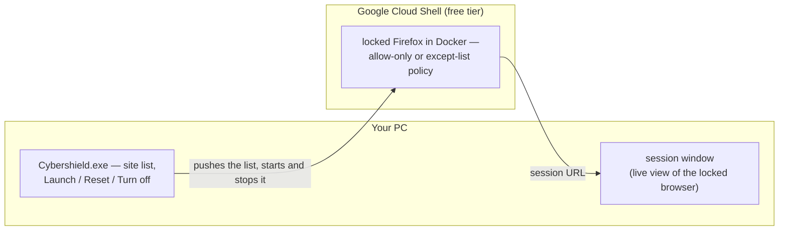
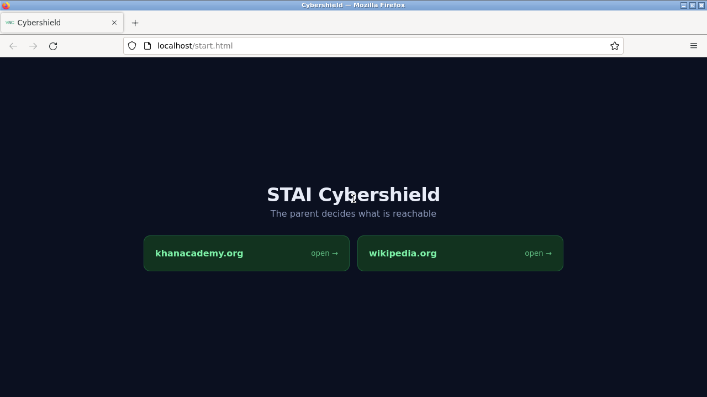
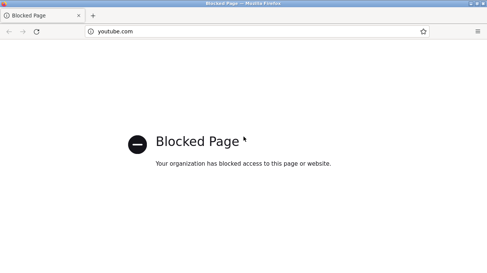

# STAI Cybershield — Cloud Shell session + Windows launcher

| File | Where it runs | What it does |
|---|---|---|
| `cloudshell-setup.sh` | Google Cloud Shell | Installs + builds + runs the locked Firefox session — also carried inside the app, so a fresh Cloud Shell needs no pasting |
| `Cybershield.exe` | Your PC | The app — website list, Launch, Reset |
| `Launch Cybershield.cmd` | Your PC | Double-click alternative that runs the source directly |
| `Rebuild Cybershield.cmd` | Your PC | Double-click this to recompile `Cybershield.exe` |
| `cybershield-launcher.ps1` | Your PC | Source of the app — **don't double-click it**, see Gotchas |
| `build-exe.ps1` | Your PC | The actual compile step, used by `Rebuild Cybershield.cmd` |
| `cybershield-sites.json` | Your PC | Your website list (created on first save) |
| `cybershield.log` | Your PC | Runtime log — every action, success or failure (created on first run) |
| `RUN-LOG.md` | — | What works, what broke, why, and what is still open |
| `DEMO-DAY.md` | — | The demo-day runbook: beats, checklist, recovery playbook |
| `hub-page.png` | — | Screenshot of the live locked session |
| `blocked-page.png` | — | What an off-list site gets — Firefox's blocked-by-policy page |

---

## How it fits together



Nothing runs on the child's machine: the locked browser lives in the cloud and
the PC app only drives it.

---

## The idea

The session can only reach the websites **you** pick. Nothing is hardcoded —
the list is edited in the app and pushed into the session every time you
launch.

Two modes:

- **Allow only these sites** — allowlist. Everything else is blocked.
- **Allow everything except these** — blocklist. Normal browsing, minus the
  sites you name.



---

## 1. Cloud Shell side — the app does it

Nothing to paste. The first **Launch session** sets Cloud Shell up by itself:
the app uploads the installer it carries, checks the upload byte for byte,
builds the image (the first run pulls ~2 GB — expect a few minutes) and starts
the session. The bar at the bottom says `session update - …` while that happens.

The Cloud Shell side is also still in `cloudshell-setup.sh`, for running it by
hand (a terminal, another machine, or recovery): paste it into a Cloud Shell
terminal and run it. It installs itself to `~/cybershield/`, builds the image,
starts the session, and sets up auto-start for later VMs.

Either way, the app then opens the session in its own app window — no address
bar, no tabs, no back button on the *outside*, so the only browser controls on
screen belong to the locked session itself.

Inside, you get a normal, maximised Firefox: back, forward, reload and an
address bar all work. The lock is enforced by the policy, not by hiding
buttons.

**Check the lock before the demo:** type a site that is **not** on your list —
with the default list, `youtube.com` — and press Enter → you should get
Firefox's blocked-by-policy page:



Then go back.

---

## 2. PC side

Just double-click **`Cybershield.exe`**. It sets itself up:

- **No Google Cloud CLI?** The button in the top-right says *Install Google
  CLI*. Click it — the app installs the Cloud CLI for you (via `winget`, or the
  official installer if `winget` isn't available). One time, ~100 MB.
- **Not signed in?** The app checks at startup and says so; the button reads
  *Sign in to Google*. Click it and a small **cmd window** opens: gcloud launches
  your browser for the Google sign-in, and the window closes by itself when
  you're done. If the browser doesn't open on its own, the login URL is printed
  in that cmd window — copy it. If anything fails, the window stays open with the
  error message until you press a key.
- Once signed in, the window says `Ready. Signed in as you@gmail.com` and the
  button becomes *Sign in again*, so you can switch accounts later.
- Both buttons stay clickable, so a failed attempt can just be retried — you
  never have to restart the app.

While anything is running, the bar at the bottom of the window tracks it:

- the phase, e.g. `Installing via winget` or `Downloading the official installer`
- a live `62% - 64.1 MB / 103.0 MB - 3.4 MB/s` line while bytes are moving
- a **sliding** bar (no percentage) once the installer itself is running — the
  Cloud SDK installer doesn't report progress, so a moving bar plus the elapsed
  clock is the honest signal
- `downloaded 71.4 MB` during the winget path, read from winget's own download
  folder, so that path isn't blind either
- an `elapsed 1:24` counter the whole time, so you can tell it hasn't hung

The same bar runs for **Launch** and **Reset**, showing what Cloud Shell is
reporting line by line. The first Launch also shows `session update - uploading
the installer, chunk 1 of 5` and `session update - building the session image`
while it sets Cloud Shell up. Every later Launch checks the session side by
checksum and updates it automatically whenever the app carries a newer version
— an updated app rolls the session forward by itself.

Then use it:

1. Type a site (`khanacademy.org`) → **Add**. Repeat. You can paste full links;
   they get trimmed to the domain, and subdomains are covered automatically.
2. Pick the mode.
3. **Launch session** — pushes the list, starts the VM, opens the browser.
4. Navigate normally *inside* the session window: back/forward/reload, or type
   a site in its address bar. Allowed sites load; everything else gets the
   blocked-by-policy page.

Your list is saved in `cybershield-sites.json` next to the `.exe`, so it's
there next time. The list is only pushed when you hit Launch or Reset.

---

## Buttons

- **Install Google CLI / Sign in to Google** — top-right. Its label follows what
  is missing: install first, then sign in, then *Sign in again*. It stays
  clickable throughout, so a retry is always one click away.
- **Launch session** — applies the website list, sets Cloud Shell up on first
  use, waits for the session, opens it in an app window.
- **Reset session** — applies the website list and restarts the container.
  A blank machine in ~10 seconds. Best demo beat: add a site, hit Reset, show
  the new site working live.
- **Turn off session** — stops the locked browser session. The screen inside
  goes dead until the next Launch (or Reset), which brings it straight back.
  Use it when the demo is over; the Cloud Shell VM itself is left alone.

---

## Gotchas

- **Never double-click a `.ps1` on this PC.** `.ps1` has no file association
  registered here, so Windows shows *"How do you want to open this file?"*
  instead of running it — and it comes back every time you try. Use
  `Cybershield.exe` to run the app and `Rebuild Cybershield.cmd` to recompile
  it. Nothing in the app opens a `.ps1` either; the script is embedded inside
  the `.exe`.
- **The app installs the Google Cloud CLI for you**, but it needs internet to do
  it, and Windows will likely show a UAC prompt — approve it. It uses `winget`
  when available; otherwise it downloads Google's own installer, which you click
  through. Either way it's a one-time, ~100 MB download, and it's fine to install
  it *before* the demo day.
- The app finds the CLI automatically after installing (it re-reads the PATH),
  so there's no need to restart it.
- **Your default browser must be signed into the same Google account** that owns
  the Cloud Shell. The preview proxy is locked to that account, so nobody else
  can open the URL — screen-share for judges.
- Changing the list takes effect on the **next Launch or Reset**, not live.
  Firefox reads its policy at startup.
- **Navigate inside the session window, not outside it.** The outer app window
  is only a viewer; the browser with the toolbar is the one *inside* it, and
  that is the one the website list governs. (If a machine has no Edge or
  Chrome, the app falls back to opening the session in your default browser —
  in that case ignore the outer browser's own back/reload/address bar; only the
  inner one is the session.)
- Cloud Shell discards the VM after ~1 hour idle. Launch wakes it again, and
  rebuilds the session's home folder if that was wiped too — no action needed.
- After a reconnect the image may have to rebuild (~few minutes); Launch does
  that by itself, and it also rebuilds the image by itself whenever the session
  code changes. Still, pre-build before presenting.
- If the launcher says "Could not reach the session", check the internet and
  press Launch again first — the first run can take minutes. If it still fails,
  check by hand in Cloud Shell:
  ```bash
  bash ~/cybershield/setup.sh
  docker logs cybershield
  cat ~/cybershield/policy.json
  ```
- SmartScreen may warn the first time you run the `.exe` (unsigned). More info →
  Run anyway.
- Fallback if the wifi dies — the image runs locally too, using whichever list
  was last pushed:
  `docker run -p 6080:80 --shm-size=1g cybershield-demo` → `http://localhost:6080`
